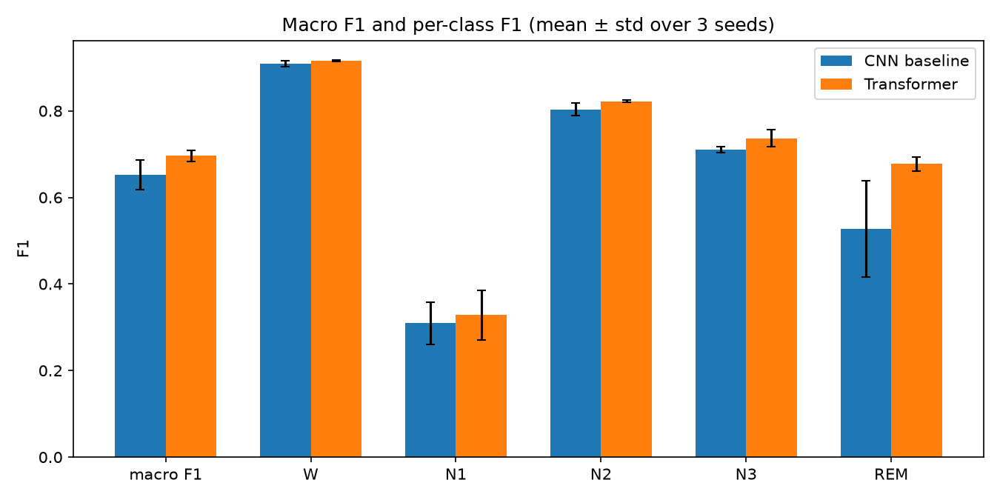
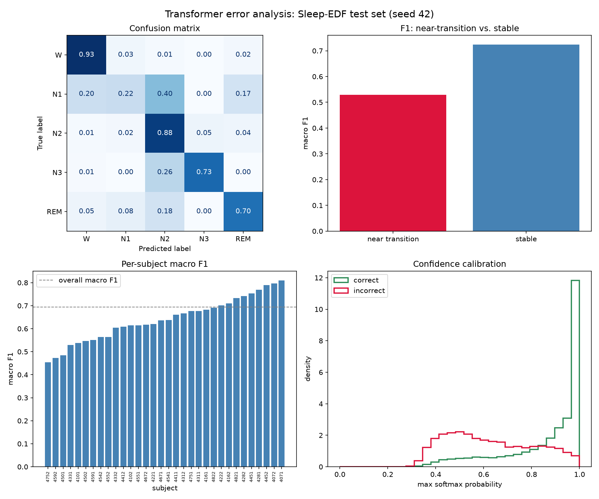

# EEG Sleep Stage Classification

Transformer vs CNN for sleep stage classification on Sleep-EDF, with a structured error analysis.

## Motivation

Sleep staging is a routine, labour-intensive task performed manually by technicians on polysomnography recordings. Automated classifiers could reduce that labour, but sleep stages are defined as much by transitions and context as by instantaneous spectral signatures — a good test bed for whether attention-based models earn their complexity over a CNN baseline.

## Methods

- **Data:** [Sleep-EDF Expanded](https://physionet.org/content/sleep-edfx/) (PhysioNet), 153 whole-night PSG recordings from 78 people (two nights each), single EEG channel (Fpz-Cz), 30-second epochs, 5-class labels (W, N1, N2, N3, REM). Preprocessing: 0.3–30 Hz bandpass, resampled to 100 Hz. Each recording is cropped to the sleep period plus 30 min of Wake either side. Split **by person** (60/20/20 of the 78 people, so a person's two nights always share a split), not by epoch, to avoid leakage.
- **Baseline:** a small 1D CNN (`src/baseline.py`) — two conv blocks, global average pool, linear head.
- **Transformer:** a patch-based transformer (`src/transformer.py`) — 0.5s patches, conv patch embedding, sinusoidal positional encoding, a handful of `TransformerEncoderLayer`s, classifier head. Sized to fit Colab's free GPU tier. Trained under identical conditions to the baseline (same loop, optimizer, schedule) for a fair comparison.
- **Error analysis:** confusion patterns, performance near stage transitions vs. stable periods, per-subject variability, and confidence calibration. See `results.md` and `notebooks/03_error_analysis.ipynb`.

## Results

Full Sleep-EDF cassette run (153 recordings from 78 people; person-level split 89/32/32 recordings; 40,460 test epochs from 16 test people; 3 training seeds, mean ± std):

| Model | Params | Macro F1 | Accuracy | REM F1 | N1 F1 |
|---|---|---|---|---|---|
| CNN baseline | 4k | 0.652 ± 0.034 | 0.760 ± 0.014 | 0.527 ± 0.111 | 0.309 ± 0.048 |
| Transformer | 171k | 0.696 ± 0.013 | 0.786 ± 0.002 | 0.677 ± 0.017 | 0.328 ± 0.058 |

The transformer is ahead by ~0.044 macro F1, and almost all of the gap is REM (+0.15). The gap holds across test people (cluster-bootstrap 95% CI [+0.029, +0.063]; the transformer is ahead for 16 of 16 people) and has the same sign in all 3 seeds, but a paired test over only 3 seeds is not significant (p = 0.21), and the models are not capacity-matched (4k vs 171k parameters), so it cannot be attributed to attention specifically. Both models fail in the same places: N1 (recall ~0.28), N3 vs N2, REM vs N2, and near stage transitions (macro F1 ~0.54 near transitions vs ~0.72 in stable stretches). Full breakdown and error analysis in `results.md`.

An earlier run had two pipeline bugs (a split that leaked a person's second night into training, and a sleep-period crop that silently did nothing); both are fixed and covered by tests, and the first-run results are archived in `results/archive_v1_recording_split/`. `results.md` explains what changed.




## How to reproduce

Local development happens in this repo with CPU-only correctness checks; actual training runs execute on Google Colab's free GPU tier (see "Development workflow" below).

```bash
python -m venv .venv
.venv/Scripts/activate        # or: source .venv/bin/activate on Linux/macOS/Colab
pip install -r requirements.txt

# Full dataset (~8GB) or a small sample for local testing:
scripts/download_data.sh            # full
scripts/download_data.sh --sample   # 1 subject, for quick local checks
```

Then run `notebooks/04_multiseed_metrics.ipynb` **first**: it is the only notebook that trains models (CNN + transformer x 3 seeds), and it saves per-run metrics and predictions to `results/`. Notebooks `01_data_baseline.ipynb`, `02_transformer.ipynb` and `03_error_analysis.ipynb` then load the saved seed-42 run (seconds, no retraining). All figures can also be regenerated without a GPU:

```bash
python scripts/make_figures.py       # figures/ from results/
python scripts/person_bootstrap.py   # CI for the CNN-vs-transformer gap, resampling test people
python -m unittest discover -s tests   # regression tests for the split and the crop
```

### Development workflow

- **Claude Code (local):** writes/debugs `src/`, validates logic on a tiny subject sample on CPU (shapes, label alignment, no crashes — not training speed).
- **Colab (GPU):** `git clone` the repo, `pip install -r requirements.txt`, run `scripts/download_data.sh`, execute the phase's notebook on the free GPU, then commit the executed notebook + results back.

## Limitations

- The CNN (4k params) and transformer (171k) are not capacity-matched, and only 3 seeds on one fixed person-level split (16 test people) were run, so the transformer's advantage is suggestive, not established.
- Single-channel EEG only (no EOG/EMG), which the clinical R&K/AASM scoring convention actually uses alongside EEG.
- No external validation on a second dataset (e.g. SHHS).
- Not a clinical-readiness claim — see `results.md` for what this project does and does not establish.

## How this was built (Claude Code–assisted)

This project was built with [Claude Code](https://claude.com/claude-code). The training runs and all reported numbers come from my own Colab runs; Claude was used for the following:

- **Mechanical and boilerplate code:** the data-loading and preprocessing pipeline, the shared training loop, the Colab workflow (train once, save metrics/predictions to `results/`, resume after disconnects, reload them in later notebooks), and the figure-regeneration scripts. Writing this by hand would have cost time that was better spent on the experiment itself, especially with only a limited Colab GPU budget.
- **Catching issues and drafting write-ups from saved metrics:** debugging pipeline problems (e.g. the per-recording normalisation failure and the N3/N4 label-merge crash), finding two bugs in AI-written pipeline code during the write-up (a split that leaked a person's second night, and a crop that silently did nothing), adding regression tests for them, and flagging the unmatched CNN/transformer parameter counts, and drafting `results.md` from the saved `results/*.json` files rather than from memory.

All numbers in `results.md` can be reproduced from the saved runs with `scripts/make_figures.py` and `scripts/person_bootstrap.py`.
